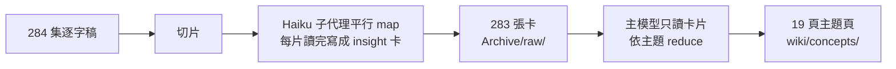

我用 Obsidian 很多年了。寫久了一定會出現三個症狀：新筆記一直加，舊筆記從來不回頭看；連結懶得補，各主題的筆記散成孤島；寫了一堆「以後調研」的 TODO，然後就沒有然後。

2025 年中，我的做法是叫 Cursor 讀完整個 vault，替特定主題生成一頁像維基百科的索引。能用，但每次都從頭讀全部筆記，又貴又慢，而且下一個工具不知道上一個工具做過什麼。

現在這個 vault 由好幾個 AI agent 一起維護：Claude Code、cmux 裡的終端 session、Claude Desktop、Cursor。這篇寫我怎麼讓它們守同一套規則，怎麼用很低的成本把幾百段 AI 對話和整季 podcast 匯進來，以及一個每週自動幫筆記補連結的背景程式。適合已經在用 Obsidian、想讓 AI 幫忙整理，又不想把 vault 弄亂的人。

## 一份所有 agent 共用的規則檔

最早的問題不是 AI 不會整理，而是每個工具各有一套習慣。某個 skill 預設替每篇筆記加 YAML frontmatter，另一個工具預設把捕捉的想法丟進 `Ideas/` 資料夾，但我的 vault 根本沒有這個資料夾。

解法是在 vault 根目錄放一個 `_CLAUDE.md`，當成這個 vault 唯一的操作規則。每次開 session，一個 SessionStart hook（session 開始時自動執行的腳本）會把它注入對話。所以不管從哪個入口進來，agent 看到的都是同一份規則。

優先順序寫在第一段：**我當場說的話 > 這份規則檔 > skill 的預設**。這條很重要，因為我裝的 Obsidian skill 有很多預設值跟我的習慣相反，規則檔要能明確覆蓋它們。

規則檔裡最常用到的幾條：

- **原子筆記不加 frontmatter。** 用自己的話寫的筆記保持純正文。只有原始存檔和收件匣裡待處理的檔案才帶 frontmatter。
- **先存檔，再蒸餾。** 原始對話、書籤清單只放 `Archive/`，一字不改。知識圖譜裡只放我自己的話寫的原子筆記，掛到對應主題的索引頁。原文是最終依據，筆記壞了可以從原文重建。
- **刪除一律軟刪除。** 禁止 `rm`，刪除就是移到 `.trash/`。這是 agent 犯錯時的恢復網。
- **每次寫入都記一筆。** 根目錄有一個只能追加的 `log.md`，格式是 `## [日期] 動作 | 描述`。到現在已經累積兩百多行。
- **哪些可以直接做、哪些要先問。** 分類、提煉、補連結可以直接做；刪除或合併現有筆記、動私人資料夾、結構性重組，要先問我。

規則檔只放「每次都要知道」的規則，細節放在 `System/` 裡的 SOP，規則檔裡留一行指引。這樣注入的內容不會越來越長。

## 導航：不建資料夾分類，用索引頁

這個 vault 的組織方式來自卡片筆記法：每則筆記只記一個想法，靠連結長出結構，不靠資料夾分類。分類像建築物，設計好之後要改就得整個重構；知識比較像神經迴路，連結會慢慢被強化或淡化。

實際上，每個主題有一頁 `【主題】` 索引頁（MOC，Map of Content），加上一個首頁，總共約 370 個 wikilink。這套索引就是整個 vault 的目錄。規則檔裡特別寫了：不要另外建 `index.md`，也不要為了「整理」去找它。不寫的話，agent 很喜歡自己建一個。

## 匯入：三階段成本篩選

2026 年 6 月我做了一次大匯入，把 ChatGPT 和 Grok 的對話紀錄導進來。最直覺的做法是全部丟給 LLM 讀，但那是最貴、也最沒必要的做法。大部分對話根本不值得留。

我把流程拆成三個階段：

1. **零 LLM 成本。** 只用腳本和標題、長度、關鍵字的正規表達式，濾掉明顯的垃圾。
2. **依規則分組，由我拍板，不讀全文。** 依標題判斷「不留痕跡跳過」「跳過但存檔」「進第三階段」。只有標題看不出來的，才做輕量的抽讀確認。
3. **只對留下來的讀全文。** 讀全文、依主題分群，寫筆記之前先在目標資料夾搜尋有沒有重複，再寫。

ChatGPT 的結果：595 段對話 → 腳本過濾後剩 340 段 → 60 段值得蒸餾 → 最後寫成 11 篇原子筆記。第三階段我還發現有 3 個候選主題其實 vault 裡早就有完整的筆記，所以「寫之前先查重」也寫進了規則。

Grok 匯入 326 段對話，收尾時我發現腳本自己產出的主清單漏了 2 到 3 條。從此多了一條收尾規則：用 ID 做一次零成本的核對，拿來源的 ID 清單跟已存檔的 ID 比對，確保 100% 覆蓋。腳本產出的清單本身也可能漏。

## 外部大量資料：map-reduce 建一個獨立的 wiki

個人筆記和外部資料要分開放。我自己的對話、筆記、書籤，資訊密度高，適合放進主題索引頁。書、podcast 逐字稿這種外部資料，量大、雜訊多，混進來會污染我自己的筆記。

所以外部資料進一個獨立的 `wiki/` 資料夾，格式也不同：每頁帶 frontmatter，開頭有一段寫給未來 AI 讀的說明（`## For future Claude`），讓 agent 用十秒判斷這頁跟問題相不相關。wiki 自己有一個很薄的 `index.md`，平常只載入這份索引，要用時再打開具體頁面。

第一批外部資料是 Lenny's Podcast 的逐字稿，我用 map-reduce 處理：

核心規則只有一條：**貴的模型絕對不讀原始全文，只碰已經蒸餾過的卡片。** 全文只由便宜的模型（Haiku）各自讀自己那一片，順便去掉廣告、時間戳和寒暄。每張卡寫成一句話的觀點、主題標籤、來源位置和相關人物。

成本：map 約用了 1,180 萬 Haiku token，合成約 90 萬 Sonnet token。如果逐篇用 Opus 處理，估計要 2,000 萬以上的 Opus token。算下來大約是原本的十五分之一到二十分之一。

這套流程後來做成了一個斜杠指令 `/ingest-wiki`，給它一個檔案或資料夾就會跑完整條流程。

這裡有一個我踩過的坑。補跑缺漏卡片時，agent 把含有跳脫字元的路徑當成字面上的資料夾名稱，在 vault 旁邊建了一個名字裡真的有反斜線的資料夾，裡面有 10 張重複的卡片。ID 核對只會檢查「該有的有沒有在」，查不出「多寫到別的地方」。現在大批 agent 寫檔之後，我會順手 `ls` 一下上層資料夾。

## Gardener：每週自動補連結的背景程式

最後一塊是解決「連結懶得補」。我寫了一個 Python 背景程式，叫 gardener，每週日凌晨 3 點跑：

1. 掃描主題筆記，用關鍵字找出可能相關的筆記。
2. 讓 LLM 判斷並生成 `[[wikilink]]`。主力用 Gemini 的免費額度；額度用完或出錯，自動改用 Claude Haiku。
3. 過濾掉死連結和低品質的目標：只連到知識筆記，排除系統檔、存檔、純數字 ID 和月報。
4. 直接寫進每篇筆記的 `## 🔗 相关（gardener 采纳）` 區塊，跟我手寫的「關聯」區分開。
5. 每篇寫入前自動備份；有真的新增連結的那一輪，才寫一筆稽核紀錄；完成後跳 macOS 通知。

它也會在每個月前 7 天，替上個月改過的筆記寫一份月報。

一開始我設計成「先提建議、我審過再寫入」。後來改成全自動，因為它只會新增帶標記的連結，不改正文，有備份，風險很低。需要先審再批的時候，可以手動跑提案模式。

這支程式的歷史並不光彩。它設定好之後其實從來沒成功跑過：排程用的 Python 沒有讀 OneDrive 資料夾的權限，一直崩潰重啟。修好之後第一次試跑，又發現它會替自己產生的月報補連結，還會建議連到系統檔和純數字的書籤 ID。上面第 3 步的過濾，就是這樣一條一條加上去的。

> **TODO(Morris)**：補一個 gardener 實際加過的連結例子（哪兩篇筆記被連起來、為什麼合理），最好附截圖。讀者需要看到它的產出長什麼樣。

## 分工：Obsidian 是介面，agent 是處理器

整套系統背後的原則寫在我的資料接入 SOP 第一行：**Obsidian vault 是唯一的匯聚點和介面，agent 是處理器，MCP 能不加就不加。**

- **匯入和互動是兩件事。** 各個來源（X 書籤外掛、Notion 同步腳本、手動匯出的對話）用自己的腳本把 markdown 寫進 vault。我不讓 Claude 直接連每個外部 API。
- **快速查找留在 Obsidian。** 「我之前在哪記過 X」用語義搜尋外掛或內建搜尋就夠，不值得開 agent。
- **重活交給 agent。** 合併、重構、跨來源綜合、寫長文、跑同步腳本，這些多步驟又要讀寫檔案的工作才開 Claude Code。

> **TODO(Morris)**：放一張 vault 的截圖（例如某個【主題】索引頁或 graph view），遮掉私人資料夾名稱。這篇講的是結構，沒有圖讀者很難想像。

## 我的結論

讓 AI 管理第二大腦，難的不是讓它會寫筆記，而是讓它守規矩。我花最多時間的地方都是規則：誰的設定優先、什麼可以直接做、刪除怎麼救回來、怎麼確認沒有漏。

省錢的方法也很一致：能用腳本就不用 LLM，能用便宜模型就不用貴的，貴的模型只讀蒸餾過的東西。

如果你要從一件事開始，我會建議先寫那份規則檔，再讓任何 agent 碰你的 vault。我怎麼決定哪些 AI 工具值得留，寫在 [[Claude Code skill 怎麼評估要不要留？我用實驗看板把 X 書籤變成限時實驗]]；平行開多個便宜 agent 的做法，寫在 [[Claude Code 接免費模型多開平行跑：我的 Magpie + cmux 做法]]。
