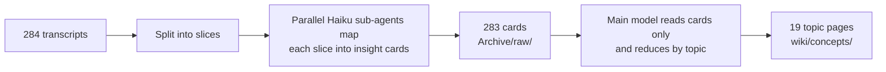

I've used Obsidian for years, and long-term use produces the same three symptoms for everyone. New notes keep piling up while old ones never get revisited. Links don't get added, so each topic turns into an island. And the "research this later" TODOs just sit there.

In mid-2025 my fix was to have Cursor read the whole vault and generate a Wikipedia-style index page for a topic. It worked, but it reread everything every time, which was slow and expensive. And the next tool had no idea what the previous one had done.

Today the vault is maintained by several AI agents at once: Claude Code, terminal sessions in cmux, Claude Desktop, Cursor. This post covers how I keep them on one set of rules, how I imported hundreds of AI chat logs and a full podcast archive for very little money, and the background job that adds links between notes every week. It's written for people who already use Obsidian and want AI to help maintain it without wrecking it.

## One rules file every agent reads

The first problem wasn't that AI couldn't organize notes. It was that every tool had its own defaults. One Obsidian skill added YAML frontmatter to every note. Another dropped captured ideas into an `Ideas/` folder my vault doesn't have.

The fix is a file called `_CLAUDE.md` at the vault root. It is the single source of truth for how to operate on this vault. A SessionStart hook (a script that runs whenever a session opens) injects it into the conversation, so every agent sees the same rules no matter which app it came in through.

The first section sets precedence: **what I say in the moment > this file > any skill's defaults.** That line matters because many of the Obsidian skills I installed ship defaults that contradict how I work, and the rules file needs explicit authority to override them.

The rules I lean on most:

- **Atomic notes have no frontmatter.** Notes written in my own words are plain text. Only raw archives and unprocessed inbox items carry frontmatter.
- **Archive first, distill second.** Raw chats and bookmark dumps live only in `Archive/`, unedited. The knowledge graph holds only notes I've rewritten in my own words, each linked from a topic index. The archive is the source of truth: if a distilled page gets mangled, it can be rebuilt from the original.
- **No hard deletes.** `rm` is banned. Deleting means moving to `.trash/`. That's the safety net for when an agent gets something wrong.
- **Every write gets logged.** An append-only `log.md` at the root gets one line per vault operation, `## [date] action | description`. It's past 200 lines now.
- **Clear lines on what needs permission.** Classifying, distilling and linking happen without asking. Deleting or merging existing notes, touching private folders, or restructuring requires my OK.

The rules file only holds what every session needs. Task-specific detail lives in SOP documents under `System/`, with a one-line pointer from the rules file, so the injected context doesn't keep growing.

## Navigation: index pages, not folder hierarchies

The vault follows the Zettelkasten idea: one idea per note, and structure grows out of links rather than folders. A folder taxonomy is like a building: once it's designed, changing it means a rebuild. Knowledge works more like neural pathways that get stronger or weaker over time.

In practice, each topic has a Map of Content page, plus one home page, about 370 wikilinks in total. That set of pages is the vault's index. The rules file says so explicitly and tells agents not to create a separate `index.md`. Without that line, agents love to make one.

## Imports: a three-stage cost filter

In June 2026 I imported my ChatGPT and Grok histories. The obvious move is to feed everything to an LLM. That's also the most expensive move, and mostly wasted, because most chats aren't worth keeping.

So the import runs in three stages:

1. **Zero LLM cost.** Scripts filter on title patterns, length and keyword regexes to drop obvious junk.
2. **Rule-based buckets, I make the call, nobody reads full text.** Each conversation gets sorted by title into skip without a trace, skip but archive, or move to stage three. Only ambiguous titles get a quick spot check.
3. **Full text only for survivors.** Read, cluster by topic, search the target folder for existing notes on the same thing, then write.

For ChatGPT that meant 595 conversations, 340 after the script filter, 60 worth distilling, and 11 atomic notes in the end. Stage three also turned up three candidate topics I already had full notes on, so "search for duplicates before writing" became a rule too.

The Grok import was 326 conversations. While wrapping up, I found that the script's own master list had missed two or three of them. That led to a closing rule: after every import, run a zero-cost ID check that diffs the source IDs against archived IDs, so coverage is verifiably 100%. The script's list can be wrong too.

## Large external sources: a separate map-reduce wiki

Personal material and external material are kept apart. My own chats, notes and bookmarks are dense and belong in the topic index pages. Books and podcast transcripts are huge and noisy, and mixing them in would pollute my own notes.

External sources go into a separate `wiki/` folder with a different format. Each page has frontmatter and opens with a short section addressed to future AI readers (`## For future Claude`), so an agent can decide in a few seconds whether the page is relevant. The wiki has its own thin `index.md`. Agents load only that index by default and open specific pages when they need them.

The first external source was the Lenny's Podcast transcript archive, processed with map-reduce:

There is one core rule: **the expensive model never reads raw transcripts, only distilled cards.** Each Haiku sub-agent reads only its own slice and strips ads, timestamps and small talk along the way. Every card holds a one-line insight, topic tags, a source location and the people involved.

The cost was roughly 11.8M Haiku tokens for the map step and about 0.9M Sonnet tokens for synthesis. Processing each episode one by one with Opus would have taken an estimated 20M+ Opus tokens. That puts the map-reduce run at about 1/15 to 1/20 of the cost.

The pipeline is now a slash command, `/ingest-wiki`. Point it at a file or folder and it runs end to end.

One failure worth sharing: when re-running a few missing cards, an agent treated an escaped path as a literal folder name and created a sibling folder with actual backslashes in its name, holding 10 duplicate cards. The ID check only verifies that everything expected exists. It can't catch files written somewhere else. After any bulk write by agents, I now run `ls` on the parent folder.

## The gardener: a weekly linking daemon

The last piece goes after "links never get added." I wrote a Python daemon called the gardener that runs every Sunday at 3 a.m.:

1. Scan topic notes and find likely related notes by keyword.
2. Ask an LLM to judge the candidates and produce `[[wikilinks]]`. Gemini's free tier is the primary model; if it hits its quota or errors, it falls back to Claude Haiku.
3. Filter out dead links and low-value targets. It only links to knowledge notes and skips system files, archives, numeric IDs and monthly reports.
4. Write the links into a dedicated "related (gardener)" section in each note, separate from my handwritten links.
5. Back up each note before writing, log an audit entry only for runs that actually added links, and post a macOS notification when done.

During the first seven days of each month it also writes a review of the notes I changed the previous month.

I first built it as propose-then-approve. I later switched it to fully automatic, because all it does is add clearly marked links. It doesn't touch the body text, and every note is backed up first, so the risk is low. A manual propose mode is still there if I want to review first.

Its history isn't flattering. After I set it up, it never actually ran: the Python that launchd used had no permission to read the OneDrive folder, so it crash-looped. Once that was fixed, the first real run linked its own monthly reports and suggested links to system files and numeric bookmark IDs. The filters in step 3 were added one bug at a time.

> **TODO(Morris)**：Add one real link the gardener added (which two notes it connected and why that's a good link), ideally with a screenshot. Readers need to see what it actually produces.

## The split: Obsidian is the interface, agents are the processors

The principle behind all of this is the first line of my ingestion SOP: **the vault is the single place everything converges and the interface I use. Agents are processors. Don't add MCP servers unless you have to.**

- **Ingestion and interaction are separate jobs.** Each source (an X bookmark exporter, a Notion sync script, manual chat exports) writes its own Markdown into the vault. I don't have Claude connect directly to every external API.
- **Quick lookups stay in Obsidian.** "Where did I write about X?" is a job for semantic search or the built-in search. It isn't worth an agent session.
- **Heavy work goes to agents.** Merging, restructuring, cross-source synthesis, long-form writing and running sync scripts are multi-step read/write jobs, and that's where Claude Code earns its cost.

> **TODO(Morris)**：Add a screenshot of the vault (a topic Map of Content or the graph view) with private folder names hidden. This post is about structure, and readers will struggle to picture it without one.

## Takeaway

The hard part of letting AI run a second brain isn't getting it to write notes. It's getting it to follow rules. Most of my time went into rules: whose defaults win, what can happen without asking, how to recover from a bad delete, how to prove nothing was missed.

The cost strategy is just as consistent. Use a script before an LLM, a cheap model before an expensive one, and let the expensive model see only distilled material.

If you start with one thing, write the rules file before any agent touches your vault. For how I decide which AI tools stay in this setup, see [[How to Evaluate Claude Code Skills and Plugins: I Run Them as Timed Experiments]].
