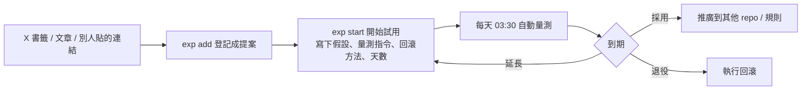

2023 年我在 X 上寫過自己處理資訊的規則：重要的轉推，重要且不會過時的按讚，需要進一步處理的（工具、網站、GitHub、方法、還沒看的文章）收進書籤。

三年後，書籤存檔超過 2,800 則。「需要進一步處理」的那些，大部分沒有被處理。

這篇講我怎麼解決這件事：把每個看起來值得試的工具、skill、外掛或工作流規則，登記成一個有期限的實驗，到期看數據決定留下還是回滾。適合裝了一堆 Claude Code skill 和外掛、卻說不出哪些真的有用的人。

## 問題不是收藏太多，是沒有判決

我做了一本帳，把收藏的外部內容逐條對到它在我電腦上「變成了什麼」。第一版涵蓋 104 條：

| 狀態 | 條數 |
|---|---|
| 已落地（真的改了規則、裝了工具、寫了程式碼） | 4 |
| 部分落地 | 3 |
| 只寫成筆記 | 16 |
| 完全沒落地 | 78 |
| 不適用 | 3 |

只寫成一篇筆記不算落地。照這個標準，104 條裡只有 7 條真的改變了我的工作方式。

另一個問題在反方向。裝進來的 skill 和外掛，沒有人回頭檢查。我的 Skill 看板現在列了 55 個，其中 24 個閒置：裝了 30 天以上，一次都沒被呼叫過。

所以缺的不是更好的收藏工具，而是兩個判決：新東西試了有沒有用，舊東西還該不該留。

## 機制：登記、限時試用、到期判定

我寫了一個命令列工具 `exp`，所有實驗都存在同一份 JSON 登記表裡。一個實驗的生命週期是這樣：

1. **登記。** 同步完 X 書籤後，只把能動手試的東西登記成提案。單純的閱讀筆記留在筆記裡。
2. **開始前先寫怎麼判。** 這是整套系統最重要的一步。開始試用之前，必須寫下假設、量測指令、回滾方法和天數。量測是一行 shell 指令，例如查 CI 的執行時間，或統計某個 skill 被呼叫幾次。真的沒辦法量的（「用起來順不順」那種），就留空，到期時問我自己的感受。
3. **自動量測。** 每天 03:30 有排程跑一次，依每個實驗設定的頻率取樣，把輸出存下來。量測指令失敗的話，下次開 session 時會提醒我。
4. **到期判定。** 只有三種結果：採用、延長、退役。agent 會先整理數據、提出建議，最後由我決定。
5. **執行。** 採用就推廣到其他地方；退役就跑當初寫好的回滾指令。

回滾方法一定要在開始前寫好。等到要拆的時候再想怎麼拆，通常就懶得拆了。

## Skill 看板：讓舊的也要重新爭取位置

實驗看板管「從外面進來的新東西」。Skill 看板管「已經裝在電腦上的東西」。兩邊互相觸發：

- 新裝一個 skill，自動登記成 14 天試用，每週量一次使用次數。
- 試用判定退役、但還沒移除的 skill，看板上標「待移除」，附上移除指令。
- skill 被移除時，對應的試用自動結案。
- 已經在用的 skill 也有複審。每個都會排到一個複審日，到期判定保留（90 天後再審一次）或退役。

最後這條是我後來加的。我發現只審新東西不公平，舊的 skill 也可能早就沒用了，只是沒人去看。新 skill 要挑戰舊的，登記時可以註明它要取代誰；新的被採用，舊的就自動標成待移除。

## 怎麼量「有沒有用」：A/B 盲測

有些東西用使用次數就能判斷。但像「在 CLAUDE.md 加一條規則」這種改動，次數量不出來，要比較的是加了規則前後 agent 的表現。

我為此寫了 `agent-ab`。它用同一個任務跑 N 次對照組、N 次實驗組，每次都從同一份乾淨的測試資料開始，用一個指令判定成功或失敗。判定是指令的結束碼，所以等於盲測。兩組交替跑，減少時間造成的偏差。還有一個要求：測試資料在 agent 動手之前必須是「失敗」的狀態，否則這個測試證明不了任何事。

第一次冒煙測試，我測「完成前先跑測試」這條規則：加了規則的組多用了 44% 的 token，成功率兩組都是 2/2。n=2 不能當證據，我的規則是每組至少 5 次才根據差異做決定。

## 看板上的真實案例

**已採用的。**

- **last30days 接上 X 和 YouTube：** 實測 X、YouTube、Reddit 都抓得到資料，採用。
- **Stageshow（做假產品畫面的 skill）：** 留著做 landing 首圖和商店截圖初稿，已經用它做出一個 Chrome 擴充功能的商店截圖。

**試用中，數據開始出來的。**

- **TokenEconomizer（微軟的省 token 外掛）：** 外掛本身的開銷目前是總 token 的 0.4%，hook 每次工具呼叫多約 70ms。到期時要用 `agent-ab` 比較開關外掛的成功率，因為只看省多少 token 不夠，省了 token 但做錯事更貴。
- **answer-me-with-html（把難懂的回答改成單頁 HTML）：** 第一週 73 個 session，使用 0 次。這種結果就是看板存在的理由：沒有這個數字，我會一直以為自己有在用。
- **形式驗證流程：** 在我自己的一個交易 agent 專案裡，先用狀態圖和 TLA+ 建模，找出 11 條真實的 bug 路徑，全部轉成先紅後綠的測試。同一個實驗裡其他不適用的步驟（例如每個 PR 跑 10 條雲端測試），我判定跳過。評估時這兩部分分開記。

**主動移除的。** 我移除了 compound-engineering 外掛，估計每次呼叫可以少送約 3,000 token。它最常用的功能是網路研究（75 次），我改用內建的搜尋工具替代，不夠再補。這個實驗到期時我會回頭問自己：研究品質有沒有下降。

> **TODO(Morris)**：TokenEconomizer 11/11 到期、其他 11/21 到期。發布前補上至少一個實際判定結果（採用或退役＋數字），文章才有結局。

## 我學到的事

**先寫判準，再裝工具。** 開始前不寫「怎麼算成功」，到期時一定會用感覺判斷，而感覺幾乎都偏向「好像有用，先留著」。

**「沒落地」要有定義。** 寫成筆記不算落地。這個標準一定下來，我才看清楚自己 104 條收藏裡只有 7 條真的改變了什麼。

**刪除也是結果。** 帳本建好的當天晚上，我把 73 篇沒落地的文章判定過時或不做，原文移進垃圾桶，理由記在登記表裡。登記不代表一定要試，判定「不做」也是一種完成。

**量不出來的就老實說量不出來。** 有一半的實驗沒有自動量測，只能到期問我自己。我寧可承認這點，也不要硬湊一個沒意義的指標。

> **TODO(Morris)**：放一張實驗儀表板的截圖（遮掉路徑和公司相關的實驗），讓讀者看到登記表實際長什麼樣。

如果你也是收藏比試用多的人，最小可行版本只要一張表：每個工具一列，寫上假設、怎麼量、哪天到期、怎麼回滾。到期那天強迫自己三選一。我讓 agent 平行跑大量小任務的做法，也是這樣試出來的：[[Claude Code 接免費模型多開平行跑：我的 Magpie + cmux 做法]]。整個知識庫怎麼交給 AI 維護，寫在 [[我怎麼用 AI agent 管理 Obsidian 第二大腦]]。
