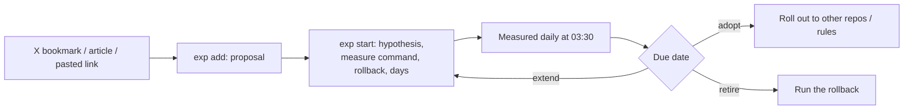

In 2023 I posted my rule for handling information on X: retweet what matters, like what matters and won't go stale, and bookmark anything that needs follow-up work (tools, sites, GitHub repos, methods, articles I haven't read).

Three years later my bookmark archive is past 2,800 entries. Most of the "needs follow-up" pile never got followed up.

This post is about how I fixed that. Every tool, Claude Code skill, plugin or workflow rule that looks worth trying now gets registered as an experiment with a deadline, a way to measure it, and a way to undo it. When the deadline hits, I keep it or roll it back based on what the numbers say. If you have a `~/.claude` full of skills and plugins and can't say which ones earn their keep, this is for you.

## The problem wasn't saving too much. It was never deciding.

I built a ledger that maps each piece of saved content to what it actually became on my machine. The first version covered 104 items:

| Status | Count |
|---|---|
| Landed (changed a rule, installed a tool, shipped code) | 4 |
| Partly landed | 3 |
| Became a note only | 16 |
| Never landed | 78 |
| Not applicable | 3 |

A note doesn't count as landing. By that bar, 7 out of 104 saves changed how I work.

The same problem ran the other way. Skills and plugins I'd installed never got looked at again. My skill board lists 55 entries today, and 24 of them are idle: installed for 30+ days, zero calls.

What I was missing wasn't a better bookmarking tool. It was two verdicts: did the new thing help, and does the old thing still deserve its spot.

## The loop: register, trial on a timer, decide at the due date

I wrote a small CLI called `exp`. Every experiment lives in one JSON registry, and a daily job renders it into two Markdown boards in my Obsidian vault plus a private local dashboard.

Here is what each step looks like in practice:

1. **Register.** After a bookmark sync, only things I can actually try become proposals. Reading notes stay notes.
2. **Write down how it will be judged before touching anything.** This is the step that matters most. Before a trial starts I record the hypothesis, a measure command, a rollback command, and the number of days. The measure is a shell command: CI run times from `gh run list`, how often a skill was invoked, a plugin's own status output. If nothing can measure it (the "does this feel better" kind), the field stays empty and I get asked how it went at the due date.
3. **Measure automatically.** A launchd job runs at 03:30, samples each running experiment on its own schedule, and stores the output tail. If a measure command starts failing, my next Claude Code session opens with a reminder.
4. **Decide.** Three outcomes only: adopt, extend, retire. The agent summarizes the stored results and proposes a verdict with the numbers. I make the call.
5. **Act on it.** Adopt means apply it more widely. Retire means run the rollback that was written on day one.

Writing the rollback up front turned out to matter. If you only figure out how to uninstall something when it's time to uninstall it, you usually don't.

## The skill board: incumbents have to re-earn their place

The experiment board handles new things coming in. The skill board handles what's already installed. They trigger each other:

- A newly installed skill automatically starts a 14-day trial, measured weekly by call count.
- A trial that gets retired while the skill is still installed shows up as "pending removal", with the removal command next to it.
- Removing a skill closes its open trial.
- Every installed skill that isn't on trial gets a scheduled review. At the review I either keep it (next review in 90 days) or retire it.

I added that last rule later. Only auditing newcomers wasn't fair. An old skill can be dead weight for months without anyone noticing. A new skill can also register as a challenger to an old one; if the challenger gets adopted, the incumbent is marked for removal.

## Measuring rules, not just tools: blind A/B runs

Call counts work for skills. They don't work for something like a new line in `CLAUDE.md`. There, the question is whether the agent behaves better with the rule than without it.

So I wrote `agent-ab`. It runs the same task N times for a control arm and N times for a treatment arm using `claude -p`. Each run starts from a fresh copy of the same fixture and is judged by a check command's exit code, which makes the judging blind. The arms alternate to spread out drift. One requirement does a lot of work: the fixture has to fail the check before any agent touches it. A check that can't fail proves nothing.

The first smoke test was a "run the tests before you say you're done" rule. The treatment arm used 44% more tokens, and both arms passed 2 out of 2. Two runs per arm is not evidence, which is why my rule is at least 5 runs per arm before acting on any difference.

## What's on the board right now

**Adopted:**

- **last30days with X and YouTube sources.** Tested X, YouTube and Reddit, all returned data. Kept.
- **Stageshow, a skill for mock product screens.** Kept for landing-page hero images and first-draft store screenshots. I've already used it for a Chrome extension's store listing.

**On trial, with early numbers:**

- **TokenEconomizer (Microsoft's token-saving plugin).** Its own overhead is 0.4% of total tokens so far, and its hook adds about 70 ms per tool call. At the due date I'll run `agent-ab` with the plugin on and off, because tokens saved don't matter if the success rate drops.
- **answer-me-with-html (answers as single-page HTML explainers).** First week: 73 sessions, 0 uses. This is exactly why the board exists. Without that number I'd keep assuming I use it.
- **Formal verification in a personal trading-agent project.** Modeling the money flow as a statechart and in TLA+ before writing code surfaced 11 real bug paths, and every one became a test that failed first and then passed. Other parts of the same workflow didn't fit (for example 10 cloud test lanes per PR), so I dropped them and score the two parts separately.

**Removed on purpose:** I uninstalled the compound-engineering plugin. My estimate is that this sends about 3,000 fewer tokens per call. Its most-used piece was a web researcher agent (75 calls). The built-in search tools replace it for now. The question at the due date is whether research quality dropped.

> **TODO(Morris)**：TokenEconomizer is due 11/11 and most others 11/21. Before publishing, add at least one real verdict (adopted or retired, with the numbers) so the post has an ending.

## What I learned

**Write the success criteria before installing anything.** If you don't, the due date turns into a gut check, and the gut almost always says "seems useful, keep it."

**Define what "landed" means.** "I wrote a note about it" doesn't count. Once I held to that, I could see that only 7 of 104 saves had changed anything.

**Deleting is a result too.** The night I finished the ledger, I marked 73 unlanded articles as stale or not worth doing, moved them to the trash, and logged why in the registry. Registering something doesn't obligate me to try it. Deciding "no" is also closing it out.

**If it can't be measured, say so.** About half my experiments have no automatic measure, and I just ask myself at the due date. I'd rather admit that than invent a metric that means nothing.

> **TODO(Morris)**：Add a screenshot of the experiment dashboard with local paths and company-related experiments redacted, so readers can see what the registry looks like.

If you save more tools than you test, the smallest version of this is a single table: one row per tool, with a hypothesis, how you'll measure it, a due date and a rollback. On the due date, force yourself to pick one of three. The bigger system it lives in is described in [[How I Run My Obsidian Second Brain with AI Agents]].
